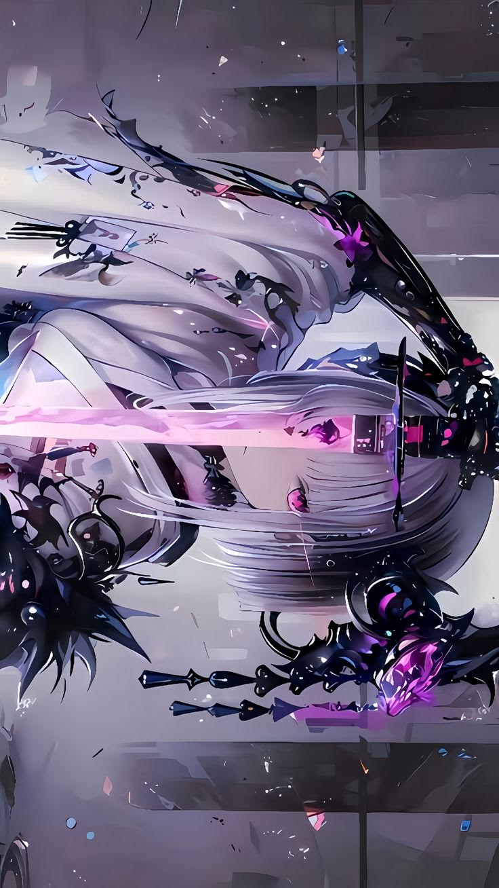
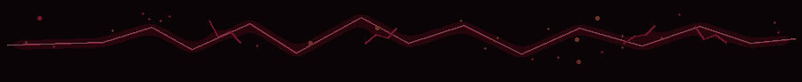

<!--
  ABISHEK SHRESTHA | RED ANIME / CRIMSON CYBER README
  Install: upload README.md and the assets/ folder to your profile repository:
  https://github.com/Abishek-C0DE5/Abishek-C0DE5
  Do not rename assets/anime-banner.png unless you also update the image path below.
-->

 

 

 

  

### `━━━━━━━━━ ⚡ NO SHORTCUTS. JUST BUILDS. ⚡ ━━━━━━━━━`

*Learning by building. Turning curiosity into projects, one experiment at a time.*

---

## ╔═══「 01 · PROFILE / DOSSIER 」═══╗

I'm Abishek Shrestha, a student from Nepal passionate about technology, AI/ML, and software development. I enjoy vibe-coding ideas into real projects, exploring automation, and learning by building.

I'm still learning, still experimenting, and still improving. I don't need to know everything today — I want to build useful things and get better with every project.

| `CORE DIRECTIVE` | `CURRENT MODE` | `LONG-TERM QUEST` |
|:---:|:---:|:---:|
| Build useful things | Learn by doing | Grow through real projects |
| `⚡ CREATE` | `⛩ EXPERIMENT` | `赤 IMPROVE` |

---

## ╔═══「 02 · SKILL LOADOUT 」═══╗

FIVE TOOLS. ONE BUILDING JOURNEY.

  

&nbsp;&nbsp;&nbsp;&nbsp;
&nbsp;&nbsp;&nbsp;&nbsp;
&nbsp;&nbsp;&nbsp;&nbsp;
&nbsp;&nbsp;&nbsp;&nbsp;

  

---

<table>
  <tr>
    <td width="50%" valign="top">

  

<h3>PYTHON</h3>

My coding toolkit for experimenting, learning programming concepts, and building practical project ideas.

</td>
    <td width="50%" valign="top">

  

<h3>VERCEL</h3>

A platform in my toolkit for deploying projects and putting ideas online.

</td>
  </tr>

  <tr>
    <td width="50%" valign="top">

  

<h3>CANVA</h3>

For visual design, creative assets, and presenting ideas with a strong visual identity.

</td>
    <td width="50%" valign="top">

  

<h3>SUPABASE</h3>

A tool in my toolkit for building projects with backend services and data.

</td>
  </tr>

  <tr>
    <td colspan="2" valign="top">

  

<h3>VIBECODING</h3>

Turning ideas into prototypes, experimenting with tools, testing results, and improving what I build.

</td>
  </tr>
</table>
## ╔═══「 03 · ACTIVE QUESTS 」═══╗

<table>
  <tr>
    <td valign="top" width="33%" align="center">

### `01`

Turn ideas into working projects and learn from each version.

</td>
    <td valign="top" width="33%" align="center">

### `02`

Experiment with tools, automation ideas, and practical ways to work.

</td>
    <td valign="top" width="33%" align="center">

### `03`

Keep learning, improving, and documenting progress through building.

</td>
  </tr>
</table>

> **「 The goal isn't to look powerful. It's to become capable. 」**

---

## ╔═══「 04 · GITHUB COMBAT LOG 」═══╗

 

These cards are loaded from third-party services. They may take time to update or occasionally be unavailable.

---

## ╔═══「 05 · CONNECTION GATE 」═══╗

  

━━━━━━━━━━━━━━━━━━━━━━━━━━━━━━━━━━

### `END OF FILE // THE GRIND CONTINUES`

Built with curiosity, a little chaos, and the will to improve. 赤

